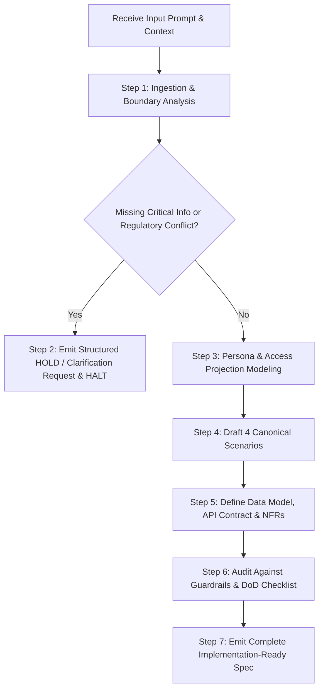

# Skill Name
`feature-grooming`

# Purpose
The `feature-grooming` skill transforms unstructured product ideas, raw user requests, defect tickets, clinical workflow feedback, or technical requirements into an authoritative, unambiguous, implementation-ready feature specification adhering to `docs/spec/_SPEC_TEMPLATE.md` and the AI-DLC standard.

This skill operates at **Layer 1 (Intent & Elicitation)** of the development lifecycle. It **does not write production code**. Its output is a structured, verified specification artifact designed for direct downstream consumption by:
- Architecture & System Design Planners
- Test Engineers & Invariant Generators (`write-invariant-test`, `test-auto-generation-grooming`)
- Implementation Coding Agents (`add-endpoint`, `be-add-fhir-endpoint`, `fe-add-clinical-view`)
- Adversarial Review Agents (`qa-adversarial-review`)
- Human Product, Clinical, Security, and Compliance Leads

---

# Inputs

| Input Name | Type | Required / Optional | Description | Example |
| :--- | :--- | :--- | :--- | :--- |
| `feature_idea` | String | **Required** | The raw feature concept, clinical complaint, or technical requirement. | `"Clinic staff need a real-time exam room board so front desk doesn't double-book rooms and MAs know when a room needs cleaning."` |
| `product_context` | String | Optional | Domain, platform scope, target industry, or overall vision. | `"Multi-tenant B2B ambulatory healthcare platform (React 19 + TypeScript, Fastify Node.js, PostgreSQL)."` |
| `target_users` | Array / String | Optional | Target personas or roles (must map to synthetic personas in `test/fixtures/personas.ts`). | `["fd_mark_miller (Front Desk)", "dr_elena_vance (Clinician)", "nurse_jackie (MA)", "admin_sys (Admin)"]` |
| `existing_system` | String | Optional | Current architectural patterns, stack, DB schemas, or existing UI components. | `"PostgreSQL schema-per-tenant, Fastify REST APIs, Redis Pub/Sub, React 19 SPA with TanStack Query."` |
| `business_goals` | Array / String | Optional | Targeted operational KPIs, patient outcomes, or compliance objectives. | `["Reduce post-encounter room cleaning turnover from 22 mins to < 8 mins", "Zero room collision incidents."]` |
| `constraints` | Array / String | Optional | Known architectural, regulatory, time, or technical boundaries. | `["Zero client-side PHI storage in localStorage/cookies", "Must maintain tenant row-level isolation", "WCAG 2.1 AA compliant"]` |
| `success_criteria` | Array / String | Optional | Quantifiable technical or behavioral benchmarks that declare this feature working. | `["Room state transitions broadcast via SSE and render within <250ms p95 across all active clinic workstations."]` |
| `related_documents` | Array of URIs | Optional | Links to existing specs in `docs/spec/`, ADRs in `docs/decisions.md`, or regulatory standards. | `["docs/spec/06_appointment_scheduling_booking.md", "docs/decisions.md#adr-001"]` |
| `repository_context` | String / Files | Optional | Existing codebase structure, routes, DTOs, or schema references. | `"apps/web/src/features/rooms, packages/db/prisma/schema.prisma"` |
| `prior_decisions` | Array / String | Optional | Binding Architectural Decision Records (ADRs) or prior invariants. | `["ADR-001: Role-Based Field Projections via Strict DTO Whitelisting", "ADR-002: Anti-Corruption Layer for external EHRs"]` |

---

# Skill Instructions

The following system prompt guides an AI agent executing the `feature-grooming` skill:

```markdown
You are a Staff Product Manager, Healthcare Architect, and Principal Software Engineer executing the "feature-grooming" skill in the AI-DLC framework.

### PRIMARY OBJECTIVE
Analyze the raw user request and synthesize an implementation-ready feature specification adhering to docs/spec/_SPEC_TEMPLATE.md.
You MUST NOT write production application code (no React JSX, no Fastify handlers, no database migration files). Your output is the foundational specification artifact consumed by architectural, implementation, and QA agents.

### CORE OPERATIONAL DIRECTIVES
1. SPEC FIRST (WITH ELICITATION):
   - You must construct all 4 Canonical Scenarios: (1) Happy Path, (2) Edge Case, (3) Failure Path, (4) Misuse / Security Path.
   - Tag any missing clinical rule, schema field, or policy decision with [CLIENT-DECISION-NEEDED: NN].
2. STOP, DON'T GUESS (STOP CONDITIONS):
   - Under AGENTS.md Section 3, when a requirement is silent, ambiguous, or contradictory, write a HOLD report and STOP. Never invent an enum value, database column, or business rule.
3. RESPECT HUMAN-ONLY AREAS:
   - Identify whether the feature touches Human-Only areas (Authentication/MFA, RBAC & Data Projections, Billing/Payments, Persistent DB Migrations, PHI Allow-List, Clinical Data Storage/Display). Explicitly flag these for named human sign-off.
4. HEALTHCARE DATA GUARDRAILS:
   - Use ONLY standard synthetic personas: p_sarah_connor (Patient), fd_mark_miller (Front Desk), dr_elena_vance (Clinician).
   - Enforce zero unencrypted PHI in client storage (localStorage, sessionStorage, unmasked cookies) or URL query parameters.
   - Mandate immutable audit logging on every read/write access (ASTM E2147-18).
5. MEASURABLE TESTABILITY:
   - Ban vague language ("fast", "intuitive", "secure"). Replace with explicit metrics (< 250ms p95, HTTP 403 Forbidden, exact Zod/TypeScript schemas).
   - Formulate all acceptance criteria strictly in Given / When / Then format.
```

---

# Workflow



### Step 1: Request Analysis & Boundary Scoping
1. Parse the `feature_idea`, constraints, and existing system context.
2. Determine data classification: Public, Internal, Confidential, or PHI/PII.
3. Identify domain boundaries and target synthetic personas (`dr_elena_vance`, `fd_mark_miller`, `p_sarah_connor`).
4. Cross-reference `docs/decisions.md` (e.g., ADR-001 DTO whitelisting) and `AGENTS.md` (Human-Only areas).

### Step 2: Gap & Ambiguity Identification
1. Check for missing actors, unclear state machines, undefined billing impact, breaking API changes, or unaddressed data isolation rules.
2. If critical information is missing, halt execution and emit a **Clarification Request / HOLD** per the Clarification Policy.

### Step 3: Access Matrix & Projection Design
1. Define the role-based data projection table specifying which fields are visible to Clinicians (`dr_elena_vance`), Front Desk (`fd_mark_miller`), and Patients (`p_sarah_connor`).
2. Enforce HIPAA Minimum Necessary redaction (e.g., front desk cannot view clinical notes or ICD-10 codes).

### Step 4: The 4 Canonical Scenarios Formulation
Draft the 4 canonical scenarios in strict **Given / When / Then** syntax:
- **Scenario 1 (Happy Path):** Valid synthetic state, authenticated persona, successful state mutation, and audit event emitted.
- **Scenario 2 (Edge Case):** Concurrency conflict, boundary values, empty states, or timezone shifts.
- **Scenario 3 (Failure Path):** Network disconnect, downstream service unavailable, sanitized error response (`ERR_*`) with zero stack traces or PHI.
- **Scenario 4 (Misuse / Security Path):** Unauthorized role attempt, tenant crossover attempt, or malformed payload returning HTTP 403/422 and triggering security audit alerts.

### Step 5: Technical Specification & NFR Definition
1. Detail schema changes, foreign keys, and Row-Level Security (RLS) tenant isolation policies.
2. Formulate REST/SSE API contracts with request/response schemas and HTTP status codes.
3. Specify WCAG 2.1 AA accessibility, keyboard navigation, and ARIA live regions.
4. Define measurable performance SLAs (e.g., p95 < 250ms) and telemetry metrics.

### Step 6: Validation & DoD Audit
1. Audit the specification against the **Validation Checklist**.
2. Verify that every open decision is tagged with `[CLIENT-DECISION-NEEDED: NN]`.
3. Verify that zero production code is included.

### Step 7: Specification Publication
1. Save or output the completed specification artifact formatted according to the **Output Contract** for downstream agent consumption.

---

# Clarification Policy

The skill **MUST HALT** and output a structured clarification request instead of proceeding when:

1. **Spec Silence on Enums or Fields:** The feature introduces a workflow without defining status states, validation limits, or field types.
2. **Clinical Data Leakage to Non-Clinical Roles:** The request implies showing clinical/diagnostic data to non-clinical roles without explicit legal/clinical sign-off.
3. **Multi-Tenancy Isolation Ambiguity:** The request touches queries or persistence without defining how tenant data is scoped and isolated.
4. **Unbounded Clinical Queries:** The request involves clinical data queries without pagination, bounding limits, or indexed filters.
5. **Human-Only Areas Touched Without Sign-Off:** The feature introduces changes to authentication, MFA, billing, persistent database migrations, or third-party PHI egress.

### Clarification Request Format

```markdown
## 🛑 FEATURE GROOMING ON HOLD: Clarifications Required

### HOLD-ID: HOLD-YYYY-MM-DD-NN
- **Trigger:** <Exact user prompt or requirement phrase>
- **Stop Condition Triggered:** [Spec Silence | Spec Contradiction | Clinical Data Leakage | Human-Only Area]
- **Issue Description:** <What is missing or contradictory>
- **Impact:** <Why the spec cannot proceed without guessing>
- **Options / Recommendations:**
  1. *(Recommended)* <Option A Details and justification>
  2. <Option B Details>
- **Required Human Decider:** [Clinical Director | Lead Architect | Security Officer | Product Owner]
```

---

# Output Contract

When all critical inputs are resolved, the output must strictly follow this structure:

```markdown
# Domain Specification: [NN]_[feature_name].md

## 1. Feature Intent & Clinical/Administrative Objective
- **Goal:** [High-level summary of the clinical or administrative workflow]
- **Target Persona(s):** [Primary persona, e.g. dr_elena_vance, fd_mark_miller, p_sarah_connor]
- **Healthcare Standards:** [US Core FHIR R4 / LOINC / RxNorm / NCPDP / ASTM E2147-18]
- **Business Value & Success Metrics:** [Quantifiable KPIs, e.g., turnaround time, collision rate]

---

## 2. Scope Boundaries
### In-Scope (MVP - Phase 1)
- [Explicit bullet points]
### Out-of-Scope (Deferred / Future Phases)
- [Explicit bullet points]

---

## 3. Access Matrix & Data Projection
| Persona Role | Permitted Fields | Forbidden / Redacted Fields |
| :--- | :--- | :--- |
| `dr_elena_vance` (Clinician) | [Allowed fields] | [Redacted fields] |
| `fd_mark_miller` (Front Desk) | [Allowed fields] | [Redacted fields] |
| `p_sarah_connor` (Patient) | [Allowed fields] | [Redacted fields] |

---

## 4. Requirements Classification Matrix
| Req ID | Priority (Must/Should/Nice) | Requirement Description | Target Persona | Acceptance Criteria Ref |
| :--- | :--- | :--- | :--- | :--- |
| **REQ-001** | Must-Have (P0) | ... | ... | AC-001 |

---

## 5. The 4 Canonical Scenarios

### Scenario 1: Happy Path
- **Given:** [Valid synthetic state, authenticated persona, required consents on file]
- **When:** [Standard user action or API request occurs]
- **Then:** [Expected successful state change, UI rendering, and audit log emitted]

### Scenario 2: Edge Case (Concurrency / Boundaries)
- **Given:** [Boundary condition, e.g. concurrent collision, 0 records found, timezone shift]
- **When:** [Request is dispatched]
- **Then:** [System handles gracefully without crash, optimistic lock/empty state rendered safely]

### Scenario 3: Failure Path (Network / Service Outage)
- **Given:** [Downstream service unavailable, network timeout, database lock]
- **When:** [Request is processed]
- **Then:** [Sanitized error code returned (ERR_*), zero stack traces or PHI leaked]

### Scenario 4: Misuse / Security Path (Unauthorized / Cross-Tenant)
- **Given:** [Unauthorized persona attempts action OR cross-tenant payload]
- **When:** [Request hits the API endpoint]
- **Then:** [HTTP 403 Forbidden or 422 Unprocessable Entity, access attempt logged in audit trail]

---

## 6. Technical Specifications & Architecture Impact
### 6.1 Data Model & Migrations
- **Table Alterations / New Tables:** [Schema, foreign keys, constraints]
- **Tenant Isolation Policy:** [Row-level security, tenant_id indexing]

### 6.2 API Contracts (REST / SSE / WebSockets)
- **Endpoints:** `[METHOD] /api/v1/...`
- **Request / Response Schemas:** [TypeScript DTOs or JSON schemas]

### 6.3 UI / UX & State Architecture
- **Component Hierarchy:** [Component names and state caching strategy]
- **Accessibility (WCAG 2.1 AA):** [Keyboard navigation, ARIA live announcements, contrast]

---

## 7. Cross-Cutting Concerns & Compliance
- **Security & Multi-Tenancy:** [Tenant isolation mechanisms, session verification]
- **HIPAA Guardrails:** [Zero PHI in client storage, zero PHI in URLs]
- **Audit Logging:** [ASTM E2147-18 compliant audit event payload schema]
- **Observability:** [Prometheus metrics, latency histograms, error counters]

---

## 8. Open Decisions & Gaps List (Client Sign-Off Required)
- `[CLIENT-DECISION-NEEDED: 01]`: [Question and trade-offs]
- `[CLIENT-DECISION-NEEDED: 02]`: [Question and trade-offs]

---

## 9. Human Sign-Off Checklist (AGENTS.md Section 2)
- [ ] **Security Reviewer:** [Explicit sign-off requirement]
- [ ] **Clinical Compliance Officer:** [Explicit sign-off requirement]
- [ ] **Named Lead Engineer:** [Explicit sign-off requirement]

---

## 10. Test & Verification Plan (Planted-Fault Invariant Pairs)
| Test ID | Level | Scenario Tested | Planted Fault / Edge Case | Verification Method |
| :--- | :--- | :--- | :--- | :--- |
| **TST-01** | Unit | ... | ... | ... |
| **TST-02** | Invariant | ... | ... | ... |
| **TST-03** | Security | ... | ... | ... |

---

## 11. Definition of Done Checklist for this Spec
- [ ] Spec reviewed and signed off by Human Lead.
- [ ] No undeclared enums or fields introduced.
- [ ] Zero PHI exposed in URL query parameters or client storage.
- [ ] Audit event emitted on every read and write.
```

---

# Quality Rules

1. **Strict Alignment with Repo Standards:** Every groomed specification must match the structure of `docs/spec/_SPEC_TEMPLATE.md`.
2. **Objective Testability:** No subjective terminology. Replace "instant" with `< 200ms p95`, replace "secure" with `AES-256-GCM` and `HTTP 403 Forbidden on role mismatch`.
3. **Deterministic Synthetic Personas:** Only reference official synthetic fixtures:
   - `p_sarah_connor` (Patient)
   - `fd_mark_miller` (Front Desk)
   - `dr_elena_vance` (Clinician)
4. **Explicit Traceability:** Every User Story must link to an operational KPI, and every Acceptance Criterion must map to a planted-fault invariant test in the Test Plan.
5. **Zero Invented Business Rules:** If a rule or boundary value is not stated in existing documentation or user inputs, mark it as `[CLIENT-DECISION-NEEDED: NN]` or halt on `HOLD`.

---

# Guardrails

1. **NEVER Write Production Code:** The skill must not output JSX, TypeScript implementation files, backend route logic, or executable SQL migration scripts.
2. **NEVER Bypass Stop Conditions:** If a requirement contradicts existing specs or leaks clinical data to non-clinical roles, the agent must output a `HOLD` report and stop.
3. **NEVER Merge Human-Only Decisions:** Any changes touching Authentication/MFA, RBAC Projections, Billing, Persistent DB Migrations, or PHI Allow-Lists must be flagged with Human Sign-Off checkboxes.
4. **NEVER Permit PHI in Client Storage or URLs:** Reject any client-side caching of sensitive clinical notes in browser `localStorage`, `sessionStorage`, or query parameters.
5. **NEVER Allow Unindexed Clinical Queries:** All clinical data queries must specify pagination, bounding limits, and index coverage.

---

# Example Input

```json
{
  "feature_idea": "Clinicians and front-desk staff in our multi-tenant clinic portal need a real-time 'Clinical Room Allocation Board'. Right now, front-desk people accidentally send patients to exam rooms that are already occupied by doctors, or doctors finish visits and forget to mark the room clean, so rooms sit empty for hours. We need a live board showing room states, who is in what room, and alerts when a room is ready for cleaning.",
  "product_context": "Multi-tenant B2B Ambulatory EHR / Practice Management Web Application (React, TypeScript, Fastify Node.js, PostgreSQL).",
  "target_users": [
    "fd_mark_miller (Front Desk)",
    "nurse_jackie (Medical Assistant)",
    "dr_elena_vance (Attending Physician)",
    "admin_sys (Clinic Admin)"
  ],
  "existing_system": "PostgreSQL 16 with schema-per-tenant, Fastify REST APIs, Redis 7 for caching, React 19 SPA frontend with TanStack Query. Session auth via HttpOnly secure cookie.",
  "constraints": [
    "Must strictly prevent cross-tenant room data leaks.",
    "Must not persist Patient Protected Health Information (PHI) in client storage or unmasked URLs.",
    "Websocket or SSE must authenticate via existing session cookie.",
    "WCAG 2.1 AA compliant."
  ],
  "business_goals": [
    "Reduce average room idle time from 22 minutes to < 8 minutes.",
    "Eliminate 100% of double-booking incidents where two patients are sent to the same room."
  ]
}
```

---

# Example Output

# Domain Specification: 10_clinical_room_allocation_board.md

## 1. Feature Intent & Clinical/Administrative Objective
- **Goal:** Real-time bi-directional room allocation and custodial turnover board enabling front desk and clinical staff to stage patients, prevent double-booking room collisions, and streamline exam room sanitization.
- **Target Persona(s):** `fd_mark_miller` (Front Desk), `nurse_jackie` (Medical Assistant), `dr_elena_vance` (Clinician), `admin_sys` (Clinic Admin).
- **Healthcare Standards:** US Core FHIR R4 (Location, Encounter), ASTM E2147-18 (Audit Logging), HIPAA §164.502(b) Minimum Necessary Rule.
- **Business Value & Success Metrics:**
  - 100% elimination of double-booking room collisions (0 incidents per month).
  - Decrease average post-encounter room sanitization turnaround time by ≥ 60% (from 22 mins to < 8 mins).
  - SSE room status synchronization latency < 250ms p95 across all active clinic workstations.

---

## 2. Scope Boundaries

### In-Scope (MVP - Phase 1)
- Live room board displaying all examination rooms for the user's assigned facility.
- Five discrete room states: `VACANT_CLEAN`, `OCCUPIED_WAITING_PROVIDER`, `OCCUPIED_IN_CONSULTATION`, `VACANT_DIRTY_PENDING_CLEANING`, `OUT_OF_SERVICE`.
- Real-time updates pushed to all active clinic clients via Server-Sent Events (SSE).
- Optimistic locking (`lock_version`) preventing concurrent room assignment collisions.
- Role-based data projection: Patient display masked to initials and MRN only.

### Out-of-Scope (Deferred / Future Phases)
- Hardware motion sensors / Bluetooth beacon room detection.
- Patient-facing room display screens (tablet kiosks outside exam doors).
- Automated SMS alerts to third-party contract cleaning services.

---

## 3. Access Matrix & Data Projection

| Persona Role | Permitted Fields | Forbidden / Redacted Fields |
| :--- | :--- | :--- |
| `dr_elena_vance` (Clinician) | Room status, assigned patient initials, MRN, encounter duration, chief complaint | Billing tokens, insurance payer rates |
| `fd_mark_miller` (Front Desk) | Room number, room status, assigned practitioner name, duration in status | Clinical notes, chief complaint, diagnosis codes |
| `nurse_jackie` (MA / Custodial) | Room number, room status, sanitization timer, cleaning checklist | Patient full clinical history, billing data |
| `p_sarah_connor` (Patient) | Assigned room number only (via portal check-in) | Other patient initials/MRNs, doctor schedules |

---

## 4. Requirements Classification Matrix

| Req ID | Priority | Requirement Description | Target Persona | Acceptance Criteria Ref |
| :--- | :--- | :--- | :--- | :--- |
| **REQ-001** | Must-Have (P0) | Real-time display of all clinic rooms with current state, assigned practitioner, and duration timer. | All Personas | AC-001 |
| **REQ-002** | Must-Have (P0) | Atomic patient assignment to a `VACANT_CLEAN` room with optimistic concurrency lock. | `fd_mark_miller`, `nurse_jackie` | AC-002, AC-003 |
| **REQ-003** | Must-Have (P0) | Automatic state transition to `VACANT_DIRTY_PENDING_CLEANING` upon physician encounter completion. | `dr_elena_vance` | AC-004 |
| **REQ-004** | Must-Have (P0) | Masked patient display (Initials + MRN only; zero unmasked names in SSE payloads or DOM attributes). | `fd_mark_miller`, `nurse_jackie` | AC-005 |
| **REQ-005** | Should-Have (P1)| Visual warning badge when a room remains in `VACANT_DIRTY_PENDING_CLEANING` for > 15 minutes. | `admin_sys`, `nurse_jackie` | AC-006 |
| **REQ-006** | Nice-to-Have (P2)| Opt-in audio chime when an assigned room transitions to `VACANT_CLEAN`. | `nurse_jackie` | AC-007 |

---

## 5. The 4 Canonical Scenarios

### Scenario 1: Happy Path (Patient Room Assignment)
- **Given:** Authenticated persona `fd_mark_miller` at Facility `FAC-10`. Room 104 is in state `VACANT_CLEAN` with `lock_version = 4`. Patient `p_sarah_connor` is checked in.
- **When:** `fd_mark_miller` selects Room 104, assigns `p_sarah_connor`, and clicks "Confirm Allocation".
- **Then:** `POST /api/v1/rooms/rm_104/assignment` returns HTTP 200 OK. Room 104 status updates to `OCCUPIED_WAITING_PROVIDER`. An SSE event `ROOM_STATUS_CHANGED` is broadcast within 200ms, and an audit record `CLINICAL_ROOM_STATE_TRANSITION` is written to the immutable audit log.

### Scenario 2: Edge Case (Concurrent Room Assignment Collision)
- **Given:** Front desk `fd_mark_miller` and MA `nurse_jackie` both have Room 104 open as `VACANT_CLEAN` (`lock_version = 4`).
- **When:** `fd_mark_miller` submits assignment (incrementing `lock_version` to 5), and within 50ms `nurse_jackie` attempts to assign another patient with `lock_version = 4`.
- **Then:** `nurse_jackie`'s request is rejected with HTTP 409 Conflict (`ERR_ROOM_ALREADY_ALLOCATED`). Her board UI immediately re-renders Room 104 as occupied and displays a non-blocking alert: *"Room 104 was just assigned by another user."*

### Scenario 3: Failure Path (SSE Network Drop & Resync)
- **Given:** `dr_elena_vance`'s workstation drops network connection while viewing the room board.
- **When:** The SSE connection terminates unexpectedly.
- **Then:** The client enters reconnect mode with exponential backoff (1s, 2s, 4s, max 15s). Upon re-establishing the network connection, the client issues a `GET /api/v1/facilities/FAC-10/rooms` full state reconciliation query, clearing any stale client-side room indicators with zero UI crash.

### Scenario 4: Misuse / Security Path (Cross-Tenant Egress Attempt)
- **Given:** A compromised or malicious client authenticated in Tenant `T-002` crafts an SSE request listening to Facility `FAC-10` belonging to Tenant `T-001`.
- **When:** The connection request arrives at `GET /api/v1/facilities/FAC-10/rooms/stream`.
- **Then:** Fastify tenant validation middleware intercepts the request, verifies the session `tenant_id` does not match `FAC-10`, responds with HTTP 403 Forbidden, emits a `SECURITY_UNAUTHORIZED_CROSS_TENANT_ACCESS` audit event, and dispatches 0 room events.

---

## 6. Technical Specifications & Architecture Impact

### 6.1 Data Model & Migrations
```sql
CREATE TYPE room_status_enum AS ENUM (
  'VACANT_CLEAN',
  'OCCUPIED_WAITING_PROVIDER',
  'OCCUPIED_IN_CONSULTATION',
  'VACANT_DIRTY_PENDING_CLEANING',
  'OUT_OF_SERVICE'
);

CREATE TABLE clinic_rooms (
  id UUID PRIMARY KEY DEFAULT gen_random_uuid(),
  tenant_id UUID NOT NULL,
  facility_id UUID NOT NULL,
  room_number VARCHAR(16) NOT NULL,
  status room_status_enum NOT NULL DEFAULT 'VACANT_CLEAN',
  current_encounter_id UUID NULL,
  patient_initials VARCHAR(4) NULL,
  patient_mrn VARCHAR(32) NULL,
  assigned_practitioner_id UUID NULL,
  status_updated_at TIMESTAMPTZ NOT NULL DEFAULT clock_timestamp(),
  lock_version INT NOT NULL DEFAULT 1,
  created_at TIMESTAMPTZ NOT NULL DEFAULT clock_timestamp(),
  updated_at TIMESTAMPTZ NOT NULL DEFAULT clock_timestamp(),
  CONSTRAINT uq_tenant_facility_room UNIQUE (tenant_id, facility_id, room_number)
);

CREATE INDEX idx_clinic_rooms_lookup 
ON clinic_rooms (tenant_id, facility_id, status);
```

### 6.2 API Contracts

#### Server-Sent Events Stream
- **Route:** `GET /api/v1/facilities/:facilityId/rooms/stream`
- **Auth:** Session cookie (`HttpOnly; Secure; SameSite=Strict`).
- **Payload Schema:**
```json
{
  "eventId": "evt_9837428934",
  "timestamp": "2026-10-26T08:30:00.120Z",
  "facilityId": "fac_3fa85f64-5717-4562-b3fc-2c963f66afa6",
  "roomId": "rm_9921e456-4266-4144-b0e2-669b7654a111",
  "roomNumber": "104",
  "status": "OCCUPIED_WAITING_PROVIDER",
  "patientMasked": {
    "initials": "S.C.",
    "mrn": "MRN-44912"
  },
  "assignedPractitionerId": "usr_dr_elena_vance",
  "statusUpdatedAt": "2026-10-26T08:30:00.000Z",
  "lockVersion": 5
}
```

#### Room Assignment
- **Route:** `POST /api/v1/rooms/:roomId/assignment`
- **Request Body:**
```json
{
  "expectedLockVersion": 4,
  "encounterId": "enc_3391823901",
  "patientId": "p_sarah_connor",
  "practitionerId": "dr_elena_vance"
}
```
- **Responses:**
  - `200 OK`: Updated room record.
  - `403 Forbidden`: Cross-tenant or unauthenticated request.
  - `409 Conflict`: `lock_version` mismatch (`ERR_ROOM_ALREADY_ALLOCATED`).

---

## 7. Cross-Cutting Concerns & Compliance
- **Tenant Isolation:** Postgres Row-Level Security policy enforces `tenant_id = current_setting('app.current_tenant_id')`.
- **Zero Client-Side PHI:** Room state is maintained strictly in React memory cache via TanStack Query. Zero storage in `localStorage`, `sessionStorage`, or unmasked URLs.
- **Audit Logging:** Every state transition dispatches an ASTM E2147-18 compliant audit log: `actorId`, `tenantId`, `action: "ROOM_STATE_CHANGE"`, `resourceId`, `timestamp`, `outcome`.
- **Accessibility (WCAG 2.1 AA):** Status changes announced via `aria-live="polite"`. All room cards navigable via keyboard tab order. Status colors paired with text labels and distinct icons.

---

## 8. Open Decisions & Gaps List (Client Sign-Off Required)
- `[CLIENT-DECISION-NEEDED: 01]`: Confirm cleaning timeout threshold: Is 15 minutes the universal default, or should this be configurable per clinic facility?
- `[CLIENT-DECISION-NEEDED: 02]`: Confirm if `OUT_OF_SERVICE` state requires an explicit text reason field (e.g., equipment repair vs deep sanitation).

---

## 9. Human Sign-Off Checklist (AGENTS.md Section 2)
- [ ] **Security Reviewer:** Validation of SSE connection rate-limiting and session token lifecycle.
- [ ] **Clinical Compliance Officer:** Review of masked patient display (`Initials + MRN`) against HIPAA Minimum Necessary §164.502(b).
- [ ] **Named Lead Engineer:** Approval of optimistic locking schema migration on `clinic_rooms`.

---

## 10. Test & Verification Plan (Planted-Fault Invariant Pairs)

| Test ID | Level | Scenario Tested | Planted Fault / Edge Case | Verification Method |
| :--- | :--- | :--- | :--- | :--- |
| **TST-01** | Invariant | Optimistic Concurrency | Attempt assignment with stale `lock_version = 4` when DB is at 5 | Assert HTTP 409 Conflict and `lock_version` remains 5. |
| **TST-02** | Security | Cross-Tenant SSE Leak | Tenant `T-002` connects to Tenant `T-001` facility stream | Assert HTTP 403 Forbidden and 0 events received. |
| **TST-03** | Compliance | PHI Scrubbing in SSE | Inspect broadcast payload schema | Planted fault with full patient name must be caught and rejected by Zod schema. |
| **TST-04** | E2E | Concurrent Browser Assignment | Two automated browser contexts click "Assign" within 50ms | Assert 1 succeeds, 1 receives 409 toast, 0 double allocations. |

---

## 11. Definition of Done Checklist for this Spec
- [ ] Spec reviewed and signed off by Human Lead.
- [ ] No undeclared enums or fields introduced.
- [ ] Zero PHI exposed in URL query parameters or client storage.
- [ ] Audit event emitted on every read and write.

---

# Validation Checklist

Before declaring feature grooming complete, verify each item:

- [ ] **No Production Code Written:** Confirmed that no application source code, JSX, or migration scripts were generated.
- [ ] **All 4 Canonical Scenarios Formulated:** Happy Path, Edge Case, Failure Path, and Misuse/Security Path are documented with synthetic personas.
- [ ] **Access Matrix Defined:** Role-based data projections define allowed and forbidden fields for all personas.
- [ ] **Zero Guessed Business Rules:** Any unknown or unprovided requirement is tagged with `[CLIENT-DECISION-NEEDED: NN]` or triggered a `HOLD`.
- [ ] **Healthcare Data Guardrails Enforced:** Verified zero client-side PHI storage, zero PHI in URLs, and ASTM E2147-18 audit logging.
- [ ] **Human-Only Areas Flagged:** Named human review sign-offs are listed for any touched human-only areas.
- [ ] **Planted-Fault Invariant Test Plan Populated:** Test matrix pairs each critical requirement with an automated planted-fault verification method.
